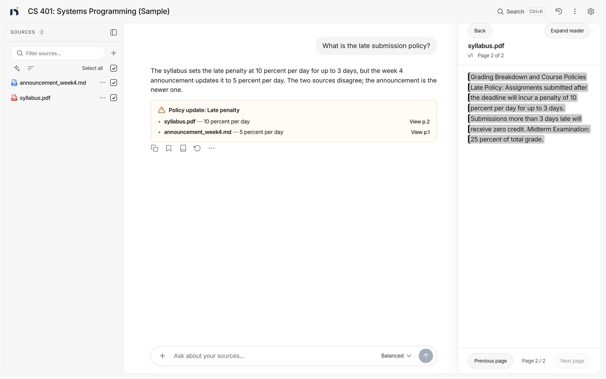
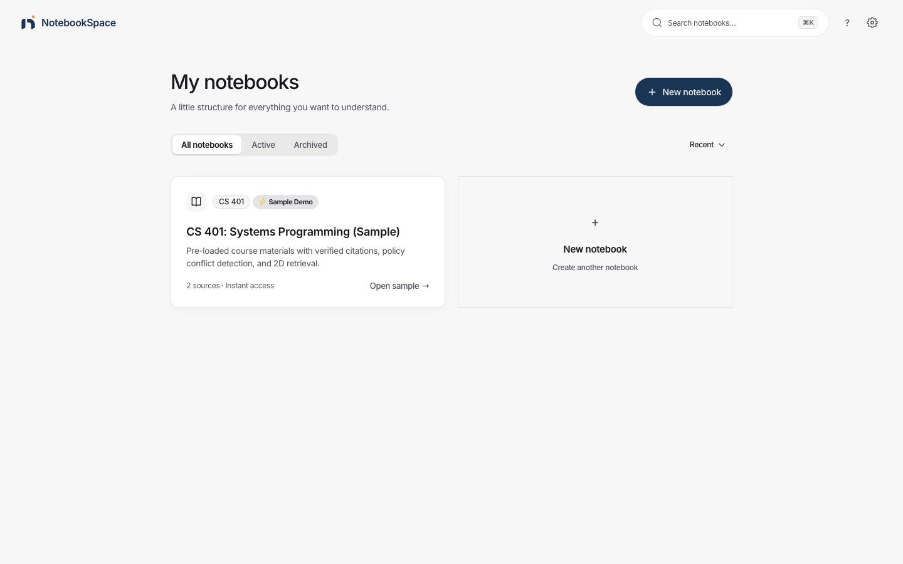
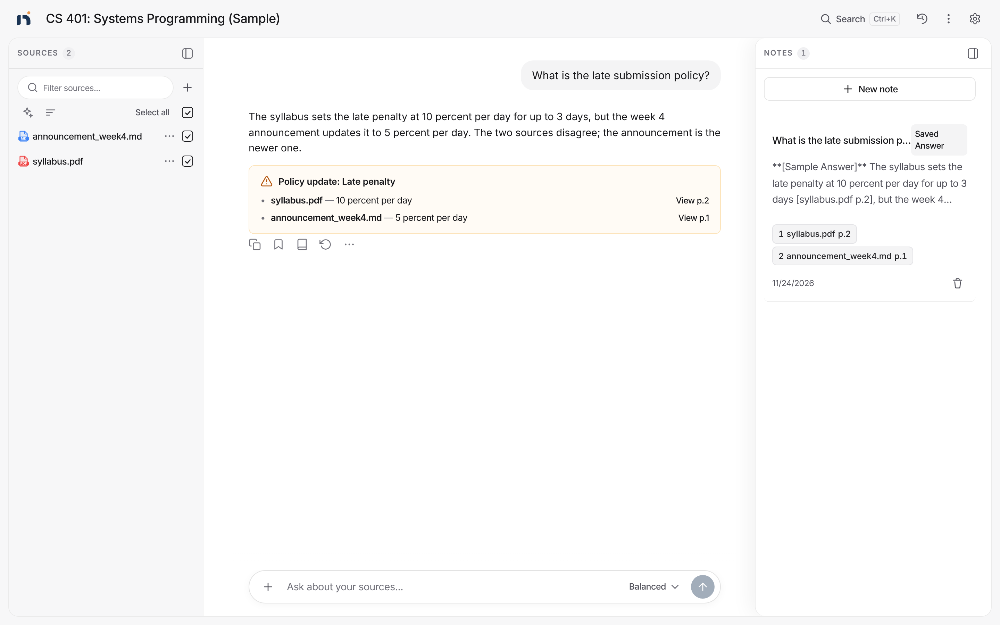
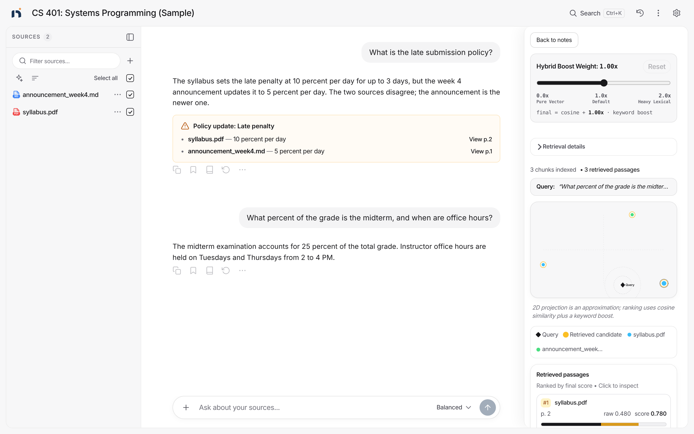

# NotebookSpace — Subject-Based Study Notebook

A study notebook in the style of NotebookLM. Create a notebook per course, add syllabi, slides and web pages, then ask questions and get answers grounded in your selected sources, with page-level citations. Save answers as notes in a built-in editor, and inspect exactly how retrieval ranked each passage.

**Live app:** [notebookspace.vercel.app](https://notebookspace.vercel.app) (frontend on Vercel · backend API on Render free tier, so the first request after idle can take up to a minute)

[](docs/media/demo-desktop.mp4)
*Click to watch the 35-second demo: open the sample notebook, check a citation, ask a new question, save the answer as a note, and inspect retrieval.*

On two 30-question sets from an OpenStax textbook, the hybrid retriever found the target page in its first five results for **17/30 (56.7%)** and **22/30 (73.3%)** questions. See the [evaluation](#evaluation) for a failure example and what I'd test next.


*Dashboard: the one-click CS 401 sample notebook.*


*Workspace: sources on the left, a grounded answer that flags the syllabus vs. week-4 announcement conflict with page-level citations, and a saved note on the right.*

## What it does

- **Notebooks per subject.** Each subject keeps its own sources, conversations, source selection and notes. Guests can open a pre-seeded sample notebook in one click.
- **Multi-format ingestion.** PDF upload (with scanned-page detection), `.txt`, `.md`, pasted text, and public web pages fetched server-side with SSRF protection.
- **Source-scoped retrieval.** Only checked sources are searched; questions outside them get an honest "not in your sources" answer instead of a guess.
- **Grounded answers with citations.** Inline citation chips like `[syllabus.pdf p.2]` open the source with the passage highlighted. When two sources disagree (e.g. a syllabus vs. a later announcement), both are cited and the conflict is flagged.
- **Retrieval inspector.** A 2D PCA plot of the query against chunk embeddings, ranked passages with raw vs. boosted scores, and a slider to tune the hybrid (semantic + keyword) weighting.
- **Note studio.** A rich-text editor in the side panel; one click saves an answer as a note with its citations. Note HTML is sanitized against XSS.


*Retrieval details: hybrid boost slider, 2D PCA projection of the query and chunks, and passages ranked by raw cosine and final score.*

## Architecture and stack

| Layer | Technologies |
| --- | --- |
| Frontend | React 18, TypeScript, Vite, KaTeX |
| Backend | FastAPI (Python 3.12), session-token auth with PBKDF2 password hashing |
| Retrieval | `all-MiniLM-L6-v2` embeddings (384-d) via FastEmbed ONNX, PostgreSQL + `pgvector`, hybrid cosine + keyword reranking |
| LLM | Google Gemini (`gemini-3.5-flash-lite` / `gemini-3.5-flash`); the API key stays on the server |
| Hosting | Vercel (frontend), Render (API), Neon (Postgres) |
| Security | Strict Content Security Policy, SSRF checks on URL ingestion (blocks private, loopback, link-local and metadata addresses), allow-list HTML sanitization for notes |

## Evaluation

The [retrieval benchmark](evals/README.md) documents the methodology. The [answer audit](evaluation/RESULTS.md) includes per-question results.

**Real-corpus retrieval.** 4 chapters (108 pages) of OpenStax *Introduction to Python Programming* (CC BY 4.0), two independently generated sets of 30 answerable questions. Hit@5 requires the expected file and page among the first five retrieved chunks.

| Metric | Set A (hybrid) | Set B (hybrid) |
| --- | :---: | :---: |
| Hit@1 | 36.7% | 46.7% |
| Hit@3 | 53.3% | 63.3% |
| Hit@5 | 56.7% | 73.3% |
| MRR | 0.442 | 0.561 |
| Abstention on absent facts | 6 / 6 | 6 / 6 |

**Synthetic course corpus (60-question benchmark).** Retrieval was evaluated on all 45 answerable questions: top-5 any-source recall 93.3% (42 / 45), and 90% of questions with conflicting sources retrieved every required source. Generation was spot-checked on 14 single-page questions: 13 / 14 factually correct, and every citation (16 / 16) supported its claim. Median generation latency 3.6 s (p95 18.3 s).

One documented miss in the synthetic course benchmark was a question about the data structure required for Assignment 1. The top five passages missed the assignment page that specified a concurrent hash map, so the answer cited the project title and left out the data structure. I'd test retrieving a larger candidate pool and reranking it before passing five passages to the model, measuring target-page recall, latency, and memory. [Case study](evaluation/RESULTS.md#4-partial-generation-results-questions-s1-to-s14) · [Reranking benchmarks](evals/README.md#3-comprehensive-experimental-matrix-set--configuration)

A smaller 35-question synthetic suite (Hit@5 100%, MRR 0.751, 8 / 8 abstentions) is documented in [evals/README.md](evals/README.md).

## Run locally

Needs Python 3.12, Node.js, and a PostgreSQL database with the `pgvector` extension.

```bash
python3 -m venv .venv && source .venv/bin/activate
pip install -r requirements.txt
cp .env.example .env          # set DATABASE_URL and LLM_API_KEY
python db/migrate.py
python tools/seed_demo.py     # optional: sample course documents
uvicorn api.main:app --reload --port 8000
```

In a second terminal:

```bash
cd frontend
npm install
npm run dev
```

To run the backend in Docker instead:

```bash
docker build -t notebookspace .
docker run -p 8000:8000 -e DATABASE_URL="postgresql://..." -e LLM_API_KEY="..." -e LLM_MODEL="gemini-3.5-flash-lite" notebookspace
```

## Tests

```bash
pytest                        # backend
cd frontend && npm test       # frontend
cd frontend && npm run build  # type check and production build
```

End-to-end journeys: `PYTHONPATH=. python tests/verify_e2e_journey.py` and `PYTHONPATH=. python tests/verify_guest_journey.py`.

### Verified quality

| Check | Result |
| --- | --- |
| Frontend tests (Vitest, GitHub Actions CI) | 297 passing |
| Backend tests (Pytest, GitHub Actions CI) | 288 passing |
| Lighthouse (Performance / Accessibility / Best Practices / SEO) | 100 / 100 / 100 / 100 |
| PageSpeed Insights (Mobile) | 99 / 100 / 100 / 100 |
| MDN HTTP Observatory | A+ |
| WAVE Accessibility | 10/10 |


## Deployment

- **Database:** Neon PostgreSQL with `pgvector`; apply migrations with `python db/migrate.py`.
- **Backend:** Render web service from `render.yaml` or the Dockerfile. Set `DATABASE_URL`, `LLM_API_KEY`, `LLM_MODEL` and `ALLOWED_ORIGINS`.
- **Frontend:** Vercel, from `frontend/`. Set `VITE_API_BASE_URL` to the backend URL; routing and security headers are in `frontend/vercel.json`.
