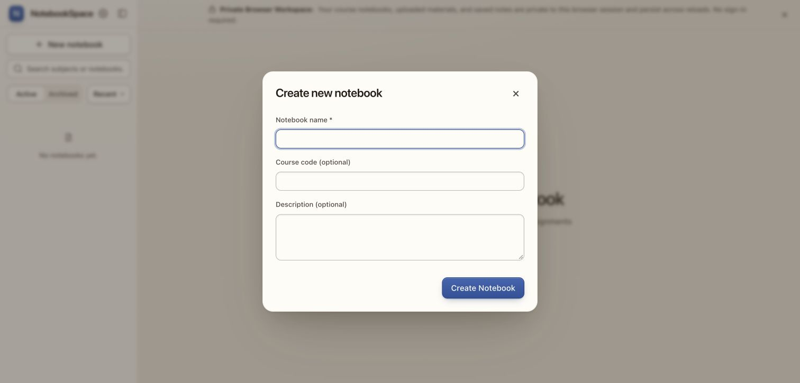

# Form and typography cleanup

- Blank notebook, note, source, sign-in, and composer fields; descriptive search hints remain.
- Removed seven redundant Cancel buttons from dialogs that already have X dismissal. Existing X, Escape, backdrop, validation, and submit behavior remain.
- Display/headings and reading use a local SF Pro Display stack; UI/body uses SF Pro Text / SF Pro. Apple system fonts are the fallback on Apple platforms; other platforms use their system sans-serif. No Apple font binaries are downloaded or bundled.
- Removed Geist/Newsreader CSS imports. The existing colour, spacing, radius, and shadow tokens remain.
- Frontend suite: 55 tests pass. TypeScript/Vite build and 256-token audit pass; no new warnings.
- Browser check: blank Create Notebook fields, no Cancel, computed font stacks, X and Escape dismissal, no console errors.

