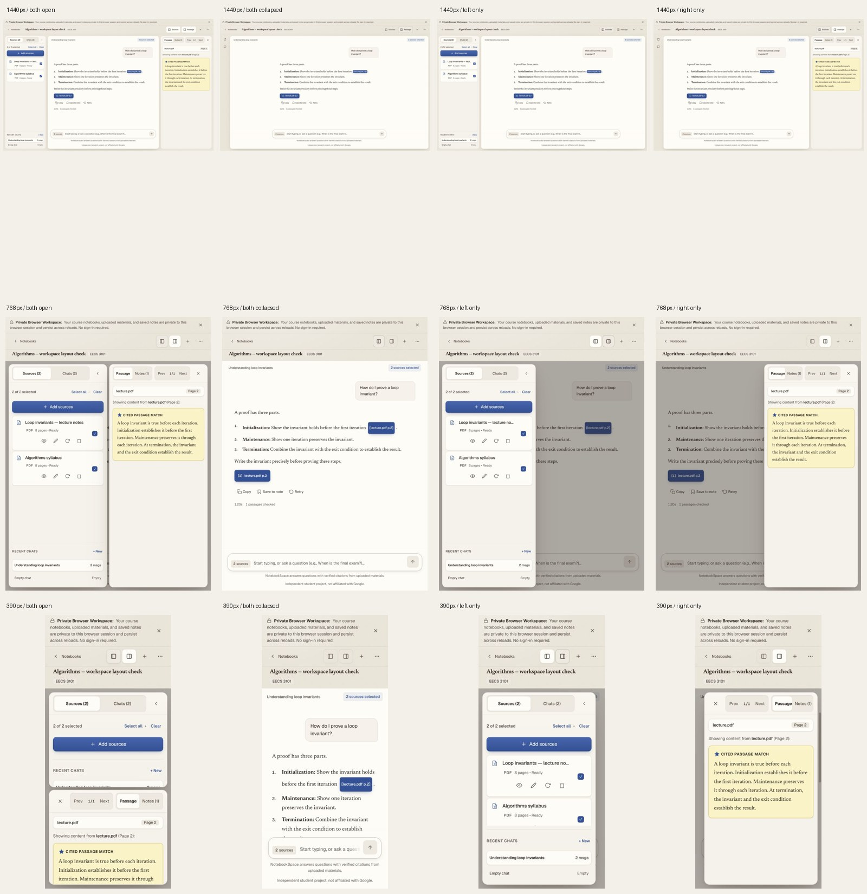

# NotebookSpace workspace layout

Branch: `design/workspace-layout`, based on main `31ebc19`. No merge or production deployment.

## Structure

- The workspace carries one notebook. The notebooks sidebar stays on the dashboard; Back returns there. Dashboard loading no longer redirects to the first notebook, and the workspace renders only on a workspace route.
- Sources and Chats share the left panel. Desktop starts open; closing it leaves a slim Sources/Chats rail. Screens at 960px and below start closed and use the persistent header toggle.
- Chat owns the conversation title, selected-source count, questions, messages, feedback, and composer. Its reading column uses the existing reading-measure token.
- Passage and Notes share the right panel, initially closed. Inline citations and citation chips open Passage at every viewport; on compact screens they close Sources and focus the inspector.
- The header contains Back, notebook title/subject tag, panel toggles, New conversation, and the actions menu. Notebook settings and Guest Workspace move into that menu. Full titles move below the controls on compact screens or when desktop space is insufficient; no title ellipsis.
- Compact panels overlay the chat, which is inert while either panel is open. Two manually opened panels appear side by side on tablets and stacked on phones. Panels retain their local state while hidden. Close/Escape returns focus to the toggle; the actions menu supports arrows, Home/End, Escape, and Tab.

## Preserved

`tokens.css`, `components.css`, Newsreader/Geist imports, dependencies, backend code, API contracts, and security fixes are unchanged. The new stylesheet controls geometry only using existing tokens. All source, conversation, note, and settings handlers remain in place.

## Validation

- Frontend: 55 tests across 6 files pass; new navigation/panel regressions included. Existing citation test now mocks passage loading and awaits asynchronous note saving.
- Backend: 188 tests pass using a dedicated local test database. One existing Starlette/httpx deprecation warning remains; no backend changes.
- Production build: TypeScript and Vite pass with no warnings.
- Token audit: 256 tokens; no app-owned literal colours or lengths outside definitions.
- Browser: no console errors. Keyboard checks cover header tab order, visible 2px accent focus ring, menu/settings access, panel toggles, Escape focus restoration, and dashboard navigation.
- All twelve captures have zero page/header horizontal overflow, `flex-wrap: nowrap`, all controls inside the bar, and no notebook sidebar. See `checks.json`.
- Exceptional long titles with an unbroken identifier retain their full text and have zero title/page/header overflow at all three widths. See `long-title-checks.json`.

Screenshots use synthetic local QA data, not personal notebooks. Captured viewports: 1440×900, 768×1024, 390×844.

| Viewport | Both open | Both collapsed | Left only | Right only |
|---|---|---|---|---|
| 1440px | [both-open](screenshots/1440-both-open.jpg) | [both-collapsed](screenshots/1440-both-collapsed.jpg) | [left-only](screenshots/1440-left-only.jpg) | [right-only](screenshots/1440-right-only.jpg) |
| 768px | [both-open](screenshots/768-both-open.jpg) | [both-collapsed](screenshots/768-both-collapsed.jpg) | [left-only](screenshots/768-left-only.jpg) | [right-only](screenshots/768-right-only.jpg) |
| 390px | [both-open](screenshots/390-both-open.jpg) | [both-collapsed](screenshots/390-both-collapsed.jpg) | [left-only](screenshots/390-left-only.jpg) | [right-only](screenshots/390-right-only.jpg) |

